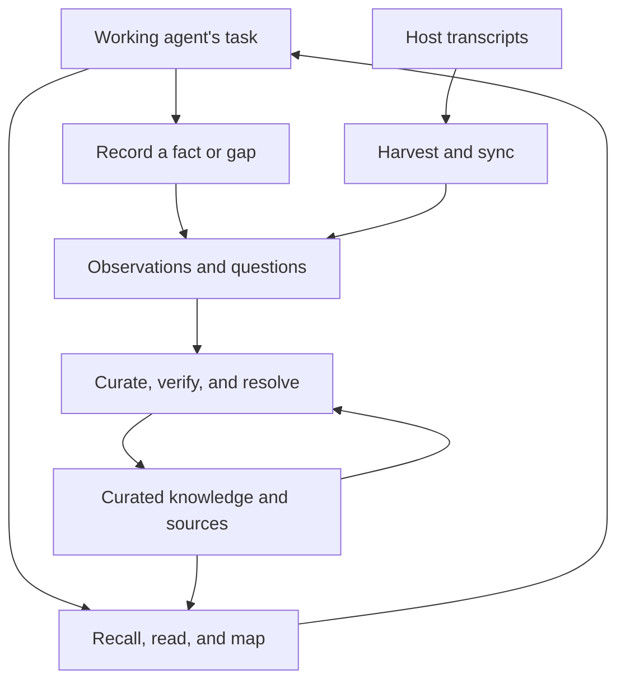

# Long-term plan

Replace knowledge-base-core with `kb`, a Python tool that serves the needs in
[users.md](users.md): retrieve what is known, preserve what is learned, turn
evidence into maintained knowledge, and make that knowledge available across
machines.

The program is complete when every scenario in `users.md` has a `kb`
replacement in use on every machine and the old tooling is archived. Feature
parity with core is not a goal. `kb` broke from core deliberately; core's
commands, options, and mechanisms are not requirements.

This document explains why the components exist, how they depend on one
another, and the order in which to build and adopt them. Temporary
`plan.md` files will turn one part of this roadmap into specific work, atomic
commits, and acceptance criteria as needed.

## Principles

- **Simple and maintainable.** Add a mechanism only when a demonstrated need
  requires it. Record the evidence for it in the notes when it is added.
- **Scenarios define capabilities.** Core's commands and the usage
  measurements explain what the old design cost; they do not define the new
  interface.
- **Portable.** Linux first. Windows next, once the Linux system works end to
  end. macOS later. The code stays portable from the start.

## Basis and scope

[users.md](users.md) defines the actors, scenarios, and settled product
decisions. [evidence.md](evidence.md) records the measurements behind those
decisions. [eval-live.md](eval-live.md) records retrieval results and their
limits.

[architecture-draft.md](architecture-draft.md) is historical design material.
Its buffer-based capture, five-event hook registration, host adapters,
session-start injection, `KNOWLEDGE_BASE` content override,
standard-library-only rule, and Claude-only first release have been
superseded. The current design uses transcript harvesting during sync, no
host hooks, `KB_CONTENT`, `detect-secrets` as the runtime dependency
exception, and Claude Code and Codex in the first release.

The implementation establishes what is built; a plan establishes what is
intended. Update this roadmap when a decision or dependency changes. Keep
measurements and detailed execution records in their own notes.

## Why this system exists

A working agent starts each session without the context of earlier sessions.
It needs relevant knowledge during another task, with little time or context
to spend finding it. The knowledge base must return useful sections in a
small number of calls, show their freshness, and state when the answer is
absent. A plausible but irrelevant result can be worse than an explicit gap.

Capture and curation solve different problems. Explicit observations preserve
facts the agent notices. Transcript harvesting preserves the conversation
when the agent does not notice what will matter later. Curation converts
both into concise, attributable knowledge that future sessions can use.
Evidence remains available so the curator's interpretation can be checked.

Core demonstrates that capture produces useful material. It is a set of
shell scripts wired to the host through per-event hooks and a dispatcher that
works only with Claude Code on Linux. It is hard to port and to maintain.
Its known weaknesses (repeated retrieval calls, an accumulating curation
queue, stale knowledge that is rarely verified, and questions that are
rarely resolved) inform the design; they are not acceptance gates.

The audience is agent sessions. Documents for the user to read belong in
`~/Wiki`; filed artifacts belong in `~/Documents`.

## How the components relate

The content repository is the durable store. It has two retrieval tiers:

- **Curated knowledge:** articles in `knowledge/` and reference documents in
  `sources/`. These are the normal answers to a recall query.
- **Evidence:** observations, transcripts, and questions. These explain where
  knowledge came from, preserve details that have not been curated, and
  expose unanswered questions.

Sync moves the content between machines as well as harvesting local
transcripts. Curation starts from synchronized evidence and ends by
publishing its changes. Setup and diagnosis make these operations available
on a machine; host configuration is static and lives in the dotfiles.

| Component | Responsibility | Why the next component needs it |
|---|---|---|
| Retrieval | Return relevant sections, readable locators, provenance, and freshness | Working agents and curators need the same view of existing knowledge |
| Recording | Preserve an attributed fact or gap in one call | Curation needs reliable input without interrupting the working task |
| Harvest and sync | Preserve transcript text and commands, track progress, and exchange content between machines | Curation needs recoverable evidence from every machine |
| Evidence access | Read provenance and deliberately search history | Agents and curators need evidence without writing custom search scripts |
| Curation | Incorporate facts, resolve gaps, verify stale claims, validate changes, and record outcomes | Retrieval quality depends on maintained content |
| Setup and diagnosis | Configure the content location, initialize content, and report what is wrong with a machine | The system must work on each machine without hooks or a shell environment |

## Commitments that carry across phases

### Preserve the content and its provenance

Continue reading the existing content repository without a wholesale
migration. Keep articles, observations, questions, source references, and Git
history usable while the old and new tools coexist. New transcript
observations have addressable turns; older observations remain readable.

Editing an article does not verify it. Freshness and unresolved conflicts
must remain visible. Verification requires checking the claim against
evidence or a live source and explicitly recording that check. Every article
carries a `ttl`, and `verified` applies to the whole article.

Upgrade `kb` on every machine before any machine writes a new content format.
`kb` carries no forward-compatibility machinery; `kb doctor` reports the
installed version so a lagging machine is visible.

### Keep retrieval separate from evidence review

Recall returns curated sections in full, with locators for further reading.
It always checks pending observations and open questions and lists matching
ones as uncurated, so a known gap is visible next to related articles.
It searches the rest of the evidence tier when no curated section matches.
Provenance and a deliberate evidence search provide access to older material
without filling normal recall output with transcripts.

Knowledge is pulled when the agent needs it. The global agent instructions
say that the knowledge base exists and when to use it; `kb map` lists its
areas on demand. Nothing is injected at session start or on each prompt.

### Share the core behavior

Use Python installed through uv, with the standard library plus the
`detect-secrets` exception. Parse Markdown through one document model. Give
each host transcript format one parser producing a neutral session model.
Keep ranking, rendering, selection, and state decisions separate from file,
Git, clock, and output operations.

Every writing command reuses the lock in `kb/lock.py` and checks supplied
text through `kb/secrets.py`. Explicit observations refuse possible secrets
so the agent can rewrite them. Transcript harvesting redacts affected lines
and preserves the remaining conversation.

The content location comes from `KB_CONTENT` or the per-machine config file.
The tooling checkout's location is not the content location.

### Keep the code portable

Operating-system behavior lives in `kb/platform.py` and the lock backends.
Each takes the platform as an argument, so every branch is tested on any
machine. CI runs the test suite on Linux and Windows. Nothing requires a
POSIX shell: `kb` runs Git with argument lists, and hosts and schedulers call
`kb` by name or absolute path. The content repository stores text with LF
line endings (`* text=auto eol=lf`).

### Capture independently of host hooks

Harvest the host's own transcripts during `kb sync`. Keep user and assistant
text and shell commands. Raw tool output and reasoning stay outside the
content repository. Raw transcripts are archived on the NAS by
`agent-session-backup` (`~/Projects/agent-session-backup`), a separate tool
that runs hourly on dirac and einstein and never deletes from the NAS. `kb`
does not depend on it.

The settled capture policy is a 60-minute idle period, at most 50 sessions
per run in oldest-first order, continued observations for later messages,
and separate observations for subagents. Harvest treats every transcript the
same way and the curator triages all of them; excluding a kind of transcript
would need code to identify it. Subagent observations name their parent
session for context. Forked sessions do not duplicate their shared opening
messages. Committed observations carry enough progress
information to recover after interruption or recloning.

The operating system's scheduler runs `kb sync` every 15 minutes: a systemd
user timer on Linux, Task Scheduler on Windows, launchd on macOS. Capture
uses `harvest_since` as its cutover boundary; it does not depend on
`KNOWLEDGE_OBSERVE`, a minimum-message threshold, or per-message buffers.

### Keep curation deliberate and resumable

The user starts curation manually, on one machine at a time. Automatic
harvesting does not start automatic curation. The curator interprets and
edits knowledge; the tools preserve state, bring related material into
context, validate changes, and record dispositions.

A run synchronizes the curating machine with the shared remote and processes
the available evidence. Other machines may be offline or unsynchronized;
observations they publish later are handled in later runs.

Finishing a curation run commits and pushes its work. Its summary must be
reconstructable from the commit. A Git conflict stops synchronization and is
resolved manually; the tool does not choose between conflicting claims.

### Use static host configuration, not hooks

`kb` registers no host hooks and does not depend on coat-tree. Each host's
global instruction file (Claude Code `CLAUDE.md`, Codex `AGENTS.md`) carries
a fixed block of about ten lines: what the knowledge base is, when to search,
when to record, that subagents do not record, and the working-agent
subcommands. Details live in `kb --help` and the skills. The content
repository's `AGENTS.md` reaches the agent through an import where the host
supports one; otherwise the block names its path.

The working-agent command set is `kb recall`, `kb read`, `kb map`,
`kb questions`, and `kb evidence` for read-only access, plus `kb observe` and
`kb gap` for explicit recording. Applying these commands to the installed host
allow rules is rollout work; phase 2 does not change installed host rules.
The host checks each part of a compound command, so nothing else is approved.
`kb sync` and the curation commands prompt.

`kb lint`, `kb verify`, and `kb resolve` are curator commands. `kb lint` is
read-only, but it is not a working-agent command or an allow rule. Verification
and question resolution change content and remain prompt-gated.

The dotfiles own the instruction block, the allow rules, and the scheduler
entry. Add a hook only when a scenario is shown to need one.

## Scenario coverage

Checked on 2026-10-27 at `3d3cfb7`:

| Scenario | Covered by | State |
|---|---|---|
| W1 Recall during a task | `kb recall` | Built; quality work continues |
| W3 Explore an area | `kb map`, `kb read` | Built |
| W4 Record a fact | `kb observe` | Built |
| W5 Record a gap | `kb gap` | Built |
| H1 Session start | Instruction block from `kb setup --print instructions`; the dotfiles install it | Built on fixtures; not installed in the dotfiles |
| H2 Capture the conversation | Harvest in `kb sync` | Built and validated on real data; not enabled (2026-10-27, `ed5a02d`) |
| H3 Session end | Covered by H2 | Superseded |
| H4 Tool approval | Allow rules from `kb setup --print allow-claude` and `allow-codex`; the dotfiles install them | Built on fixtures; not installed in the dotfiles |
| C1-C6 Curation | Phase 3 | Built on fixtures (synchronized start, finish, content hook); not adopted |
| U1 Set up a machine | `kb setup`, phase 4 | Built on fixtures (config, hook, `--init`); not run on a real machine |
| U2 Bring machines together | `kb sync` | Built |
| U3 Diagnose a failure | `kb doctor`, phase 4 | Built on fixtures; on this machine it names the setup work that remains |
| U4 Set policy | Content `AGENTS.md` import in the instruction block | Built on fixtures; the policy line is rendered from the configured content path |

The current phase 5, part 1 plan is [`plan.md`](../plan.md) at the repository root.

[plan-retrieval.md](plan-retrieval.md) and
[plan-observe.md](plan-observe.md) preserve the earlier component plans.
[plan-phase1-review.md](plan-phase1-review.md) preserves the phase 1 review
fixes, closeout, and outstanding Windows criteria. Phase 2 now provides
`kb gap`, `kb questions`, and `kb evidence`; recall also surfaces matching
open questions and qualifying transcript message locators. Linux checks and
real-content read-only validation are recorded in `notes/evidence.md`.
Message locators remain fixture-validated because the real store has no
addressable transcripts. The first native run of the Windows CI job remains.
Harvesting has not been enabled on any machine, and installed host allow
rules have not been updated. Phase 3 now includes local batch selection,
next-item context, outcomes, and archive recovery, as well as `kb lint`,
`kb verify`, and `kb resolve`. It is not synchronized or published: the
synchronized start, finishing commit and push, content pre-commit hook, and
one-time `ttl` assignment pass remain outstanding. Core's `curate` skill
remains operational until the synchronized workflow is built and adopted.
No-match recall latency has a separate follow-up to reach <= 5 seconds on the
same snapshot. [plan-phase3-batches.md](plan-phase3-batches.md) and
[plan-phase3-publication.md](plan-phase3-publication.md) preserve the phase 3
plans, and [plan-phase4-setup.md](plan-phase4-setup.md) preserves the phase 4
plan.

Update this table when a plan finishes. Retirement requires every row to be
covered and in use on every machine.

## Order of work

### 1. Finish and validate harvest and sync

Phase 1 built and validated `kb sync` against scratch copies of real Claude
Code and Codex transcripts. It checked the generated observations through
`kb read` and recorded aggregate measurements in the evidence notes. The
fresh post-fix validation used revision
`ed5a02d1cfd590ff86b5735a0df150cd5869cede`; its aggregate results,
acceptance checks with source tool-result references, cleanup proof, and
continuation cut are in `notes/evidence.md`. The README documents sync and
harvesting, `contrib/systemd/` contains the Linux timer files, and CI defines
the Windows test job. The job's first native run remains the only outstanding
phase 1 item.

Enabling capture on a machine belongs to rollout, with an explicit boundary
against the old capture hooks.

### 2. Complete evidence access and gap recording — built

Build the interfaces that both working agents and curators need around
retrieval: record a gap, inspect questions, follow sources, and deliberately
search evidence by date and kind. Use addressable transcript turns in
evidence results where the observation format supports them.

This closes the gap between finding an article and checking why it says
something. It also gives unanswered questions a durable path into curation.
It depends on the existing document and locator model, the shared write
path, and the transcript format established in phase 1.

Add open questions to recall's uncurated block, in the same line format as
pending observations (requirement 8). Derive the commands from W5, C3, C4,
and requirement 8 in `users.md`, not from core's `ask`, `questions`, and
`resolve`. Final command names and output
contracts belong in the short-term plan for this phase.

Phase 2 is implemented in `kb gap`, `kb questions`, and `kb evidence`, with
matching open questions in recall. The README describes the command
contracts, real-content limits, and read/write distinction. The Linux checks
and closeout measurements are recorded in `notes/evidence.md`. Native
Windows CI remains unrun, and installed host allow rules remain rollout
work. Phase 3 has built local batch selection, next-item context, outcomes,
and archive recovery, alongside `kb lint`, `kb verify`, and `kb resolve`.
Synchronized start, the finishing commit and push, the content pre-commit
hook, and the one-time `ttl` assignment pass remain outstanding. The
separate <= 5 second no-match recall follow-up also remains open.

### 3. Build guided curation

Make curation a sequence the tool can resume from repository state:

1. Synchronize the curating machine with the shared remote and report the
   available queue, related stale knowledge, and open gaps.
2. Select a bounded set of observations that fits the session's context.
3. Present the next observation with likely destination sections and related
   questions, so the curator can compare it with existing knowledge.
4. Record incorporation, a duplicate with a named destination, or an
   ephemeral disposition. Archive only completed observations; defer work
   that cannot be completed without losing its place.
5. Check related stale claims and resolve questions when evidence supports an
   answer. Keep unverified claims stale and unresolved gaps open.
6. Validate content, links, and provenance; commit the run with a useful
   summary; synchronize its result.

Keep observations that arrive during the run outside its selected set.
Preserve unfinished work and disposition state across interruptions. The
curator continues to edit articles directly; the tool makes completion and
remaining work explicit.

Content lint and the content repository's pre-commit hook belong here because
they protect the same publication boundary. `kb lint` is built and can require
`ttl` on every new or edited article. A one-time curation pass assigns `ttl`
to articles that rely on the 60-day default (100 articles lacked `ttl` in the
2026-10-27 baseline). The hook can stamp `updated` after validation; it must
not change `verified`. Verification and question resolution are explicit
commands, but the guided run must still use them as evidence supports.

This phase depends on retrieval, evidence access, safe writes, and sync.
Until it is in use, core's `curate` skill continues to process the queue.

The validation, local-processing, and publication pieces are built on fixtures:
`kb lint` checks article structure, metadata, and references; `kb verify`
records an explicit article check; `kb resolve` records an answer or
obsolescence; local batches persist outcomes and recover interrupted archives;
`kb curate start` synchronizes before it selects; `kb curate finish` validates,
commits once, and pushes; and `kb hook pre-commit` validates and stamps every
content commit. `kb setup` installs that hook in phase 4. It is built on
fixtures and has not run on a real machine. Curation commitments C1-C6 are
built on fixtures; real use waits for phase 5 rollout and adoption. The one-time `ttl` pass is curation
work that remains to be done.
`kb lint` is for curators; do not add it to working-agent allow rules.

### 4. Complete setup and diagnosis

Provide `kb setup` for the per-machine content setting, the content
repository's pre-commit hook, and skill links, with an initialization path
for a new content repository that writes its `.gitattributes`. Use the
config file and absolute paths so GUI-launched hosts work without shell
environment variables. Document the dotfiles' instruction block, allow rules,
and scheduler entry in the README.

Provide `kb doctor`. It reports configuration, content Git state, the last
successful scheduled sync, transcript access, unharvested transcripts older
than 20 days with the host's retention setting, the allow rules, the
instruction block in each host's global file, and old-tooling hooks that are
still registered.

This phase can proceed after phase 1. Complete the parts needed to operate
capture before switching capture on.

Status: built on fixtures, and not run on a real machine. `kb setup` sets the
content path, installs the hook, creates a repository with `--init`, and prints
the host text for the dotfiles. `kb doctor` checks each fact in its table and
names the fix. Skill linking moved to phase 5 (decision 1 of the phase 4 plan),
because no `kb` skill exists yet.

### 5. Adopt on Linux and retire the old tooling

Adopt components as they become usable. Retrieval already works beside the
old system, and capture can switch before the new curation workflow is
complete. Full retirement waits until every scenario has a `kb` replacement.

Skill linking belongs here. The new `knowledge-base` and `curate` skills are
written, and setup links them, in the same change that replaces core's skill
links and updates the instruction block (phase 4 plan, decision 1).

For the capture switch on each machine, remove the old capture hooks and set
`harvest_since` at the same moment, and let the sync timer take over. Keep
the already captured history; do not backfill it. Verify capture and
synchronization from a real session before treating that machine as moved.
Record which responsibilities still use the old tooling.

Replace the old session-start and tool-approval hooks with the instruction
block and allow rules. Move recording, gap handling, and curation to their
new interfaces as each is ready. Update both skills and the instruction
block together so agents follow the installed behavior. Verify the complete
cycle across machines: learn, capture, sync, curate, publish, and recall from
a later session.

Remove the legacy `.observe.lock` protocol, stale-PID handling, and their
tests only when the old writing scripts have stopped running on every
machine. Switching capture alone does not satisfy that dependency. Remove
the remaining shims and obsolete environment variables, then archive the
old tooling.

### 6. Add Windows

Start after the Linux system works end to end and the legacy lock is gone;
its `os.kill(pid, 0)` liveness check terminates processes on Windows.
Measure Claude Code and Codex transcript locations and shapes on Windows
before changing the parsers. `agent-session-backup` schedules itself only on
Linux and macOS; a Windows machine needs its own backup schedule. Add the Task Scheduler entry and the Windows
checks in `kb doctor`. Verify the complete cycle on a Windows machine.

### 7. Extend hosts and platforms

Add OpenCode and Pi after the first rollout. Each needs a transcript parser,
an instruction block, and allow rules. Reuse the neutral session model,
observation format, write path, and sync behavior. Measure actual transcript
shapes before specifying a parser.

Add macOS when a macOS machine needs the system: a launchd entry, a CI job,
and the macOS checks in `kb doctor`.

## Retrieval quality throughout the work

Retrieval improvement runs across these phases. Maintain separate evidence
for finding the right section, rejecting irrelevant curated results, and
answering correctly from current claims. A historical section can be the
right retrieval result without being the right current answer.

Keep the synthetic suites, the heading-derived control set, and the live
questions distinct. The live labels are machine-written from session
transcripts. Labelling by the user is deferred until a small labelling
interface exists. The live evaluation notes already show missed relevant
sections and false positives on unanswerable queries, including a short-query
qualification problem. Passing the heading-derived set does not resolve
those failures.

Change ranking through general mechanisms supported by evaluation. Report
the effect on every set, including the live set, and retain failing cases.
Correct a wrong label with its reasoning rather than changing retrieval to
match it. A new search engine or semantic retrieval is a separate decision
that needs evidence of a gap the current approach cannot close.

## Deriving temporary plans

Choose the next bounded outcome whose dependencies are ready. Recheck the
implementation and the relevant evidence before turning this roadmap into
an execution plan; the dated coverage table above is not a permanent task
list.

Each temporary `plan.md` should identify the scenarios it serves, define the
specific behavior and scope, and divide implementation into atomic commits.
Give each commit observable acceptance criteria and the checks needed to
prove them. Include compatibility, recovery, and rollout details where the
change affects stored content or machine operation. Separate building a
capability from enabling it on the user's machines.

Finish or explicitly revise the current plan before replacing it. Preserve
useful component plans in `notes/`, as with retrieval and observations.
After execution, update this roadmap with the resulting capability, changed
decisions, and remaining dependencies. Keep commit checklists and test cases
in the temporary plans.
